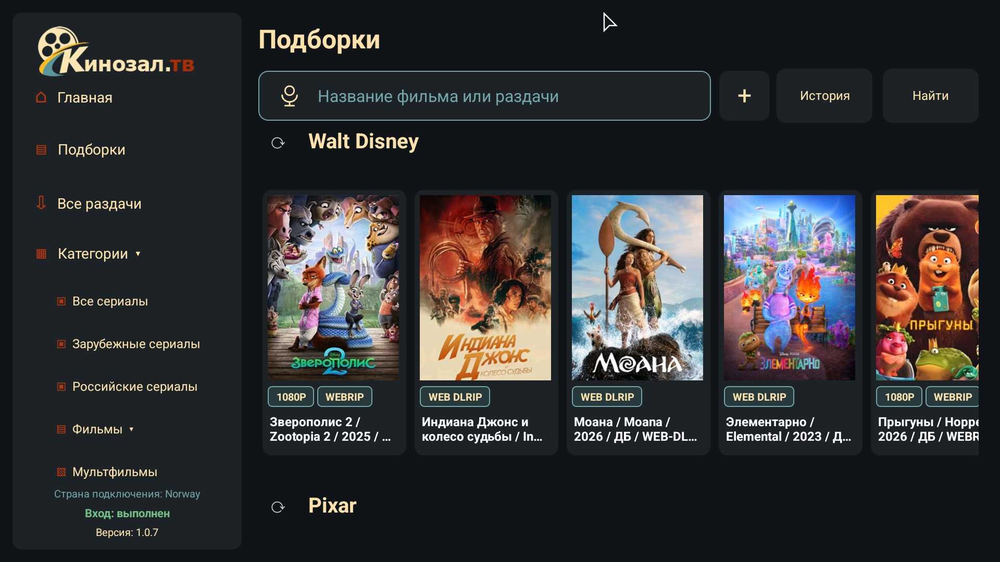
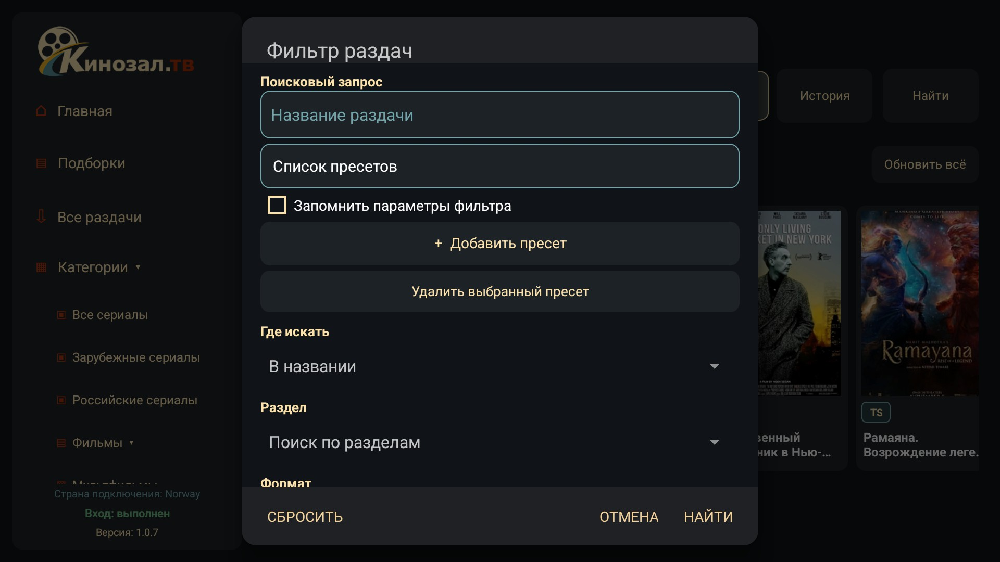

::: {align="center"}
# Кинозал ТВ

### Лёгкое приложение для поиска, просмотра и управления торрент-раздачами на Android TV

**Небольшой размер · Широкие возможности · Удобное управление с пульта**

[Скачать последнюю
версию](https://github.com/Goblin-Mini/KinozalTV-Updates/releases/latest)
:::

------------------------------------------------------------------------

## О проекте

**Кинозал ТВ** --- приложение для удобной работы с каталогом Kinozal на
телевизорах и Android-устройствах. Интерфейс адаптирован для большого
экрана и управления пультом: фильмы, сериалы, подборки и раздачи собраны
в одном приложении.

Проект **активно развивается**. Интерфейс, функции и совместимость
продолжают улучшаться, а новые возможности добавляются постепенно.

Основная идея проекта --- **малый вес приложения при широких
возможностях**. Приложение не перегружено лишними элементами, но
предоставляет инструменты для поиска контента, работы с раздачами и
организации просмотра.

## Возможности

-   **Главная страница** с новинками и тематическими подборками.
-   **Каталог раздач** с информацией о размере, дате публикации, сидерах
    и личерах.
-   **Подборки** фильмов и сериалов по темам и коллекциям.
-   **Категории** для быстрого перехода к нужному типу контента.
-   **Поиск и фильтры** с возможностью сохранять пресеты.
-   **Карточка раздачи**: описание, технические данные, релиз,
    скриншоты, похожие материалы и другие сведения.
-   **Избранное и история просмотра** для быстрого доступа к нужному
    контенту.
-   **Интеграция с TorrServe** для передачи раздач на воспроизведение.
-   **Настройки и диагностика**: зеркало, прокси, параметры интерфейса,
    резервное копирование и другие инструменты.
-   **Android TV** --- управление с помощью пульта.

Функциональность продолжает расширяться по мере развития проекта.

## Скриншоты

> Изображения для этого раздела нужно положить в папку `screenshots`
> рядом с README.md. Имена файлов должны совпадать с указанными ниже.

### Главная страница

### Подборки

### Каталог раздач

### Карточка фильма

### Фильтр раздач

### Настройки

## Лицензирование

Лицензия рассчитана на **3 устройства** и стоит **450 рублей**.

При необходимости можно докупить дополнительные устройства. Условия и
стоимость расширения лицензии уточняйте по электронной почте.

**По вопросам получения лицензии и активации:**

<kinozal.tv.klient@gmail.com>

Обратите внимание:

-   Лицензии выдаются **вручную**.
-   Обработка заявки может занять некоторое время.
-   После обращения возможна задержка с выдачей лицензии.

## Скачать приложение

Актуальные установочные APK публикуются в разделе **GitHub Releases**:

[Скачать последнюю версию Кинозал
ТВ](https://github.com/Goblin-Mini/KinozalTV-Updates/releases/latest)

Перед установкой ознакомьтесь с описанием конкретного выпуска.

## Обратная связь

Вопросы по лицензии, активации и работе приложения:

**kinozal.tv.klient@gmail.com**

------------------------------------------------------------------------

::: {align="center"}
**Кинозал ТВ --- компактное приложение с широкими возможностями. Проект
развивается.**
:::
