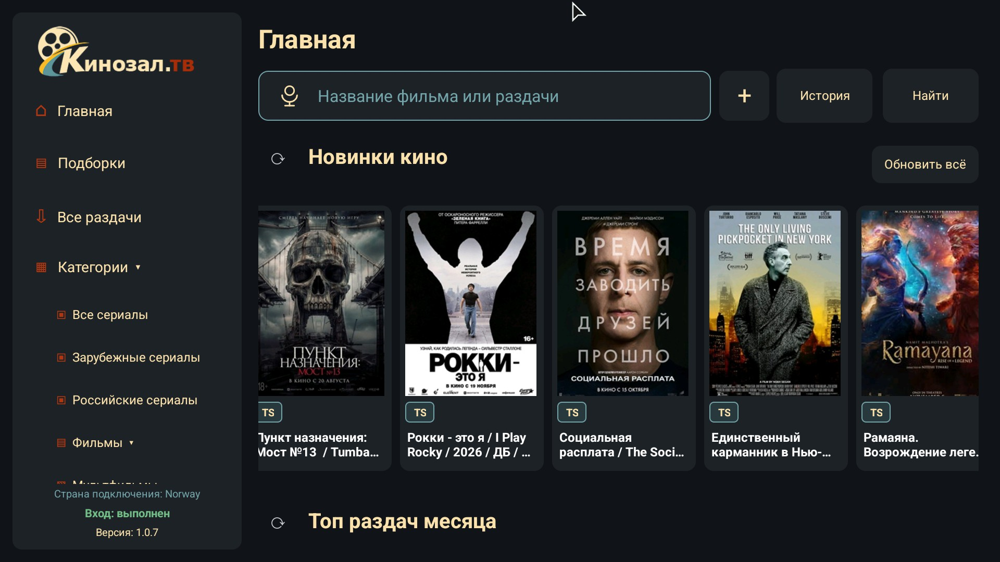
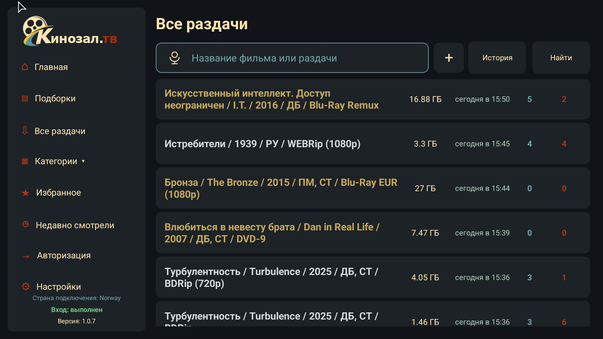
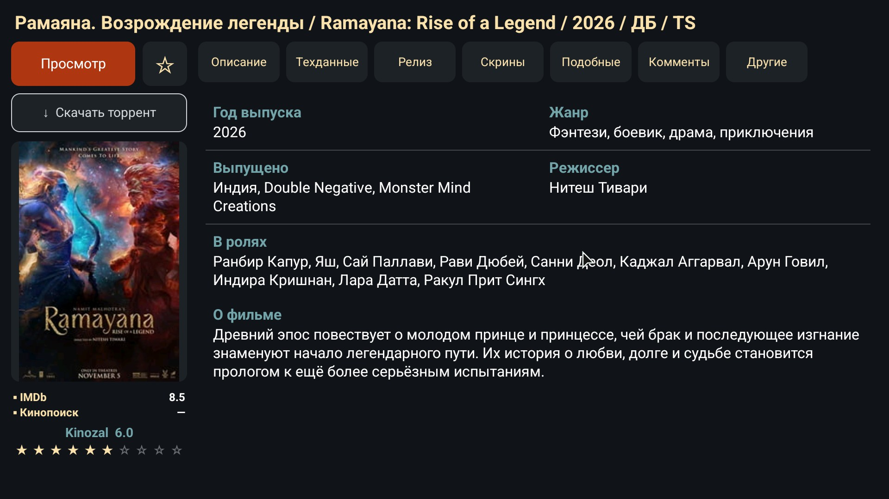
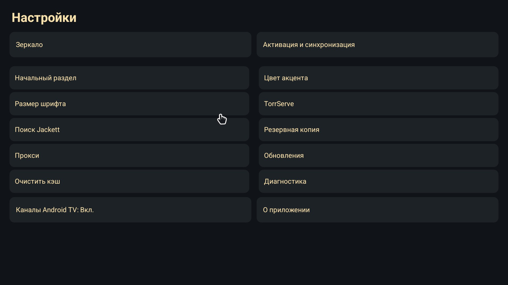

# 🎬 Кинозал ТВ

### Фильмы, сериалы и подборки — на большом экране

**Лёгкое приложение для Android TV · Малый размер · Широкие возможности**

[⬇️ **Скачать последнюю версию**](https://github.com/Goblin-Mini/KinozalTV-Updates/releases/latest)

---

## ✨ О приложении

**Кинозал ТВ** — приложение для удобной работы с каталогом Kinozal на Android TV и Android-устройствах. Фильмы, сериалы, подборки и раздачи собраны в одном интерфейсе, адаптированном для большого экрана и управления обычным телевизионным пультом.

Проект **активно развивается**: интерфейс и возможности приложения постепенно расширяются, продолжается работа над удобством и совместимостью с устройствами.

Наша идея — **малый вес приложения при широких возможностях**. Без лишней перегруженности — полезные инструменты для поиска контента, работы с раздачами и организации просмотра.

## 🚀 Возможности

- 🏠 **Главная** — новинки и актуальные подборки.
- 🎞️ **Каталог** — фильмы, сериалы и другие раздачи.
- 🧭 **Подборки и категории** — быстрый переход к интересующему контенту.
- 🔎 **Поиск и фильтры** — настройка параметров и сохранение пресетов.
- ℹ️ **Карточка раздачи** — описание, сведения о релизе, скриншоты и дополнительная информация.
- ⭐ **Избранное и история** — быстрый доступ к выбранному контенту.
- ▶️ **TorrServe** — передача раздач для воспроизведения.
- ⚙️ **Настройки** — параметры приложения и подключения.
- 🎮 **Android TV** — управление с помощью пульта.

## 📸 Скриншоты

<table width="100%">
  <tr>
    <td width="33%" align="center">
      <b>🏠 Главная</b> 
      
    </td>
    <td width="33%" align="center">
      <b>🧭 Подборки</b> 
      
    </td>
    <td width="33%" align="center">
      <b>🎞️ Каталог</b> 
      
    </td>
  </tr>
  <tr>
    <td width="33%" align="center">
      <b>ℹ️ Карточка раздачи</b> 
      
    </td>
    <td width="33%" align="center">
      <b>🔎 Фильтры</b> 
      
    </td>
    <td width="33%" align="center">
      <b>⚙️ Настройки</b> 
      
    </td>
  </tr>
</table>

## 💳 Лицензирование

**450 рублей — лицензия на 3 устройства.**

При необходимости можно докупить дополнительные устройства.

По вопросам приобретения, активации и расширения лицензии пишите:

📧 **[kinozal.tv.klient@gmail.com](mailto:kinozal.tv.klient@gmail.com)**

> Лицензии выдаются вручную. Обработка заявки может занять некоторое время — возможна задержка с выдачей.

---

**Кинозал ТВ — компактный размер, широкие возможности. Проект развивается.**

